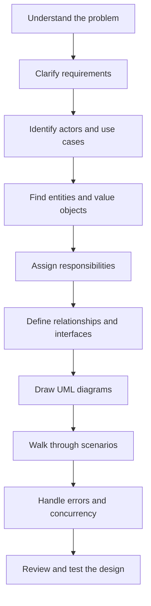
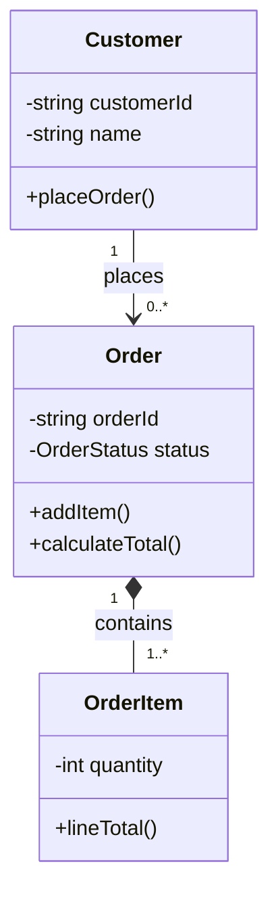
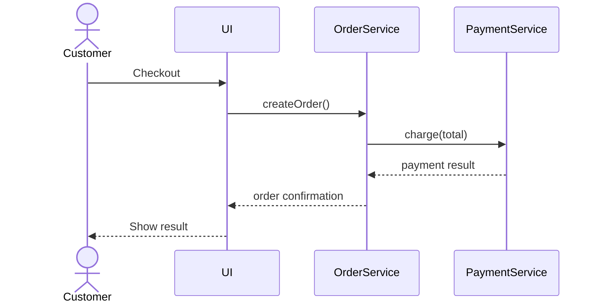
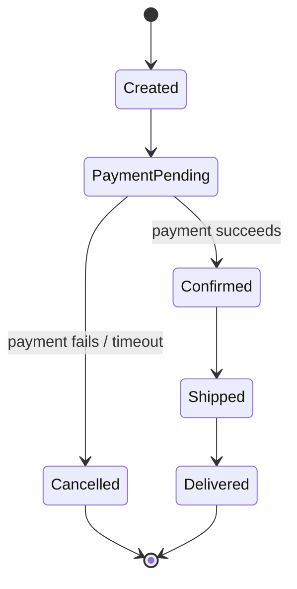
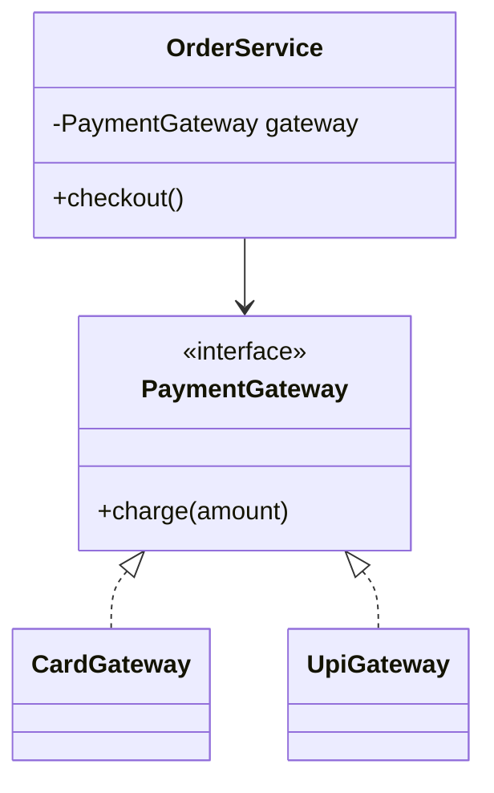

# 01 — LLD Foundations

## 1. What is Low-Level Design?

Low-Level Design describes **how the software will be built internally**. It identifies classes, objects, interfaces, methods, data, and the way objects collaborate.

Think of building a house:
- HLD is the overall floor plan: rooms, floors, entrances and utilities.
- LLD is the detailed drawing: wall dimensions, wiring, pipes, doors and fittings.

| HLD | LLD |
|---|---|
| Services and their communication | Classes and their collaboration |
| Deployment and scaling | Object responsibilities and method contracts |
| Database and high-level data flow | Entities, fields and relationships |
| Answers “what are the major parts?” | Answers “how does each part work?” |

### Typical LLD deliverables
- Functional and non-functional requirements
- Use cases and domain entities
- Class and interface diagrams
- Sequence/activity/state diagrams
- API or method contracts
- Error handling, concurrency rules and test cases

## 2. A repeatable approach to an LLD problem

1. Clarify scope. Ask what is included and excluded.
2. List actors and use cases.
3. Identify nouns (candidate entities) and verbs (candidate operations).
4. Assign one clear responsibility to each class.
5. Define relationships and multiplicities.
6. Define interfaces at points likely to vary.
7. Walk through important scenarios.
8. Check errors, concurrency, persistence and extensibility.
9. Add tests for normal and boundary cases.

### Requirement-to-design flow

## 3. OOP fundamentals

### Class and object
A class is a blueprint; an object is a runtime instance. A `Car` class describes properties and behaviour. A particular red car is an object.

### Encapsulation
Keep state and the operations that protect that state together. Do not allow arbitrary external changes to important fields.

Example: a bank account should expose `deposit(amount)` and `withdraw(amount)`, not a public balance field that any caller can overwrite.

### Abstraction
Expose what a caller needs and hide implementation details. A `PaymentProcessor` interface can expose `pay()` without revealing gateway-specific HTTP calls.

### Inheritance
A derived type reuses or specializes a base type. Use it only when the derived type genuinely satisfies the base type's contract.

### Polymorphism
The same interface can invoke different implementations. Calling `paymentMethod.pay()` may execute a card, UPI or wallet implementation.

### Prefer composition when it models the relationship better
Inheritance means “is a”; composition means “has a”. A car has an engine, so composition is more natural than making `Car` inherit from `Engine`.

## 4. UML diagrams

### Class diagram
Shows static structure: classes, attributes, methods and relationships.

### Relationship cheat sheet
- Association: two objects know or use each other.
- Aggregation: a weak whole-part relationship; the part can live independently.
- Composition: strong ownership; the part's lifecycle is controlled by the whole.
- Inheritance/generalization: one type specializes another.
- Dependency: one component temporarily uses another.

### Sequence diagram
Shows messages exchanged over time.

### State diagram
Useful when an object has a limited set of valid states and transitions.

## 5. SOLID principles

SOLID is a set of design guidelines that helps software remain understandable and changeable. It is not a checklist that requires one class per method.

### S — Single Responsibility Principle
A class should have one cohesive responsibility, or one main reason to change.

Bad: `Invoice` calculates totals, formats PDF and sends email.  
Better: `Invoice`, `InvoiceFormatter`, `InvoiceEmailer`.

### O — Open/Closed Principle
A component should allow new behaviour through extension without repeatedly editing stable existing logic.

Example: add a new `DiscountPolicy` implementation instead of adding another `if` branch to a large discount function.

### L — Liskov Substitution Principle
A subtype must be usable wherever its base type is expected without breaking the promised behaviour.

If `Bird` promises `fly()`, making `Penguin` inherit from it violates the contract. Model flying as a separate capability such as `Flyable`.

### I — Interface Segregation Principle
Prefer small, role-specific interfaces over one large interface that forces clients to implement methods they do not need.

Example: split `PrinterScannerFax` into `Printer`, `Scanner` and `Fax` capabilities.

### D — Dependency Inversion Principle
High-level policy should depend on abstractions, not concrete low-level details.

### Quick memory aid

| Principle | Ask yourself |
|---|---|
| SRP | Does this class have unrelated reasons to change? |
| OCP | Can I add a variant without editing stable logic? |
| LSP | Can every subtype honour the base contract? |
| ISP | Am I forcing clients to depend on unused methods? |
| DIP | Does business logic depend on an interface? |

## 6. Common mistakes

- Starting with classes before understanding use cases.
- Creating interfaces for every class without a reason.
- Using inheritance only to reuse code.
- Applying patterns because they sound impressive.
- Ignoring invalid states, retries and concurrent requests.
- Designing every possible future feature instead of the requirements that matter now.

## Practice

Design a library checkout flow. Identify the difference between `Book` (title/author) and `BookCopy` (a physical copy with an availability state). Draw a class diagram and a sequence diagram for borrowing one copy.
