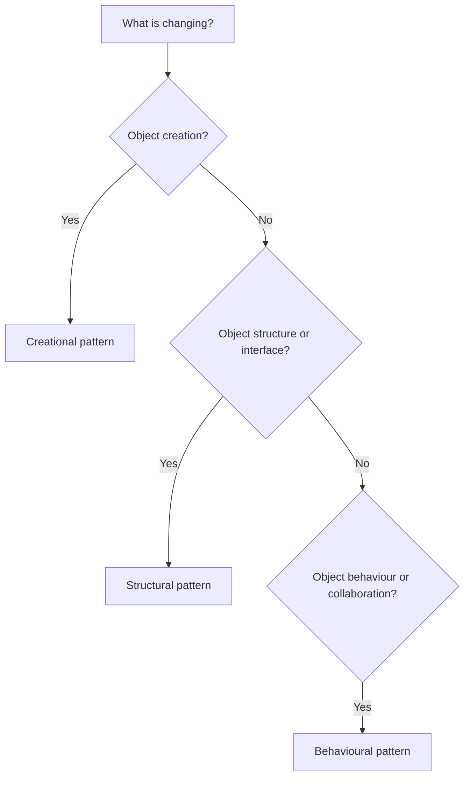
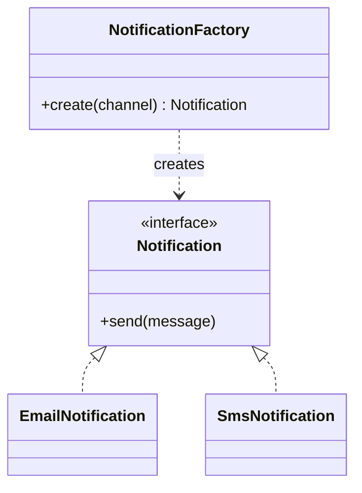
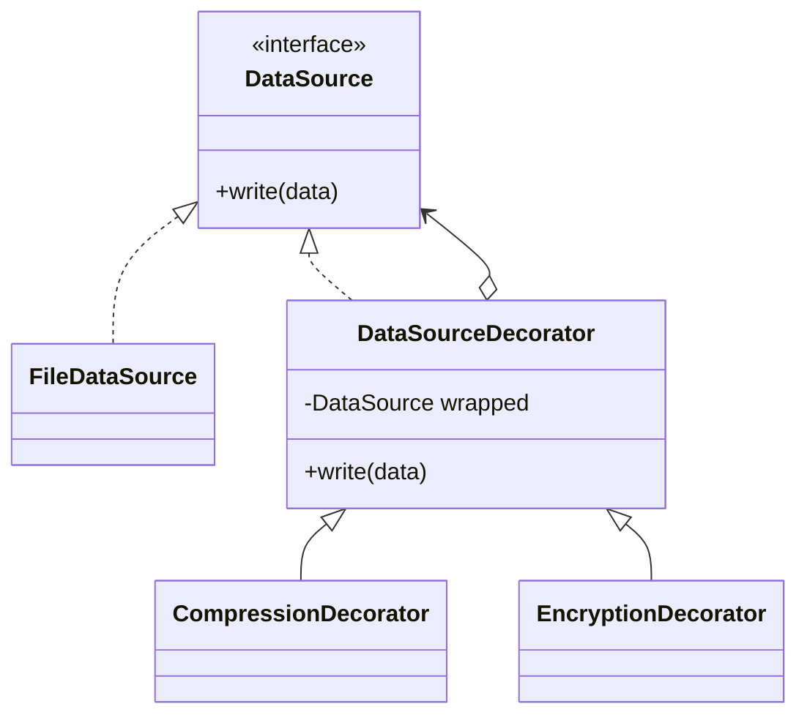
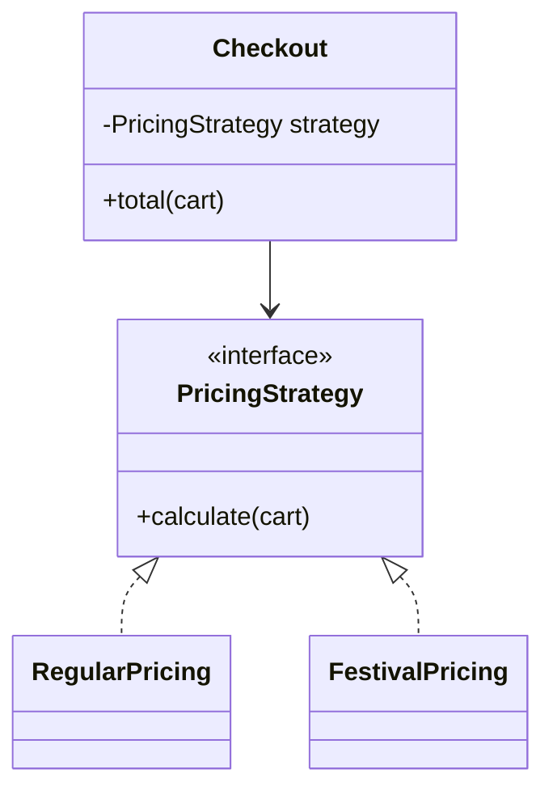
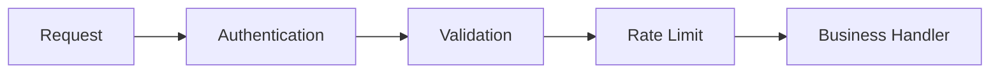
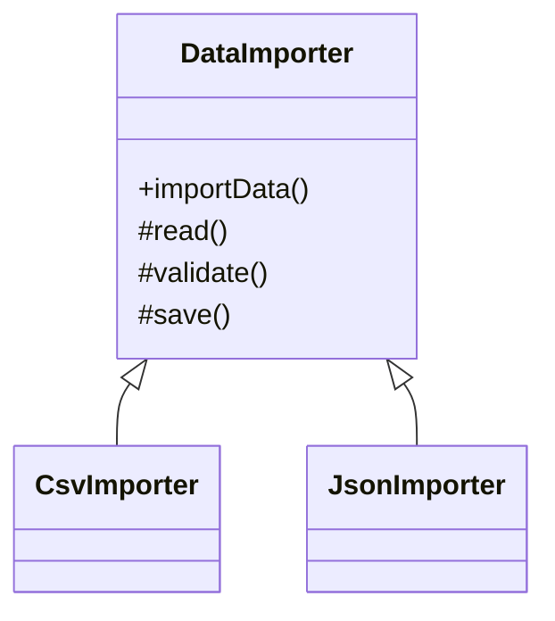
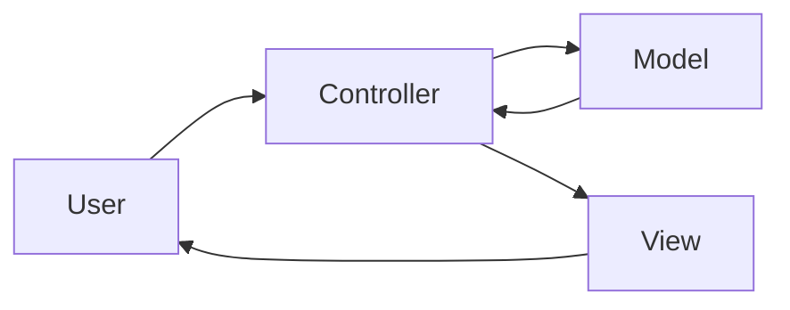

# 02 — Design Patterns

A design pattern is a reusable way to solve a recurring design problem. It is not ready-made code. Understand the problem first, then decide whether a pattern makes the design simpler.

## Pattern selection map



# A. Creational patterns

## 1. Singleton
**Problem:** A component should have one shared instance within a defined scope.

Examples: configuration registry or process-wide metrics registry. In many systems dependency injection is a better option than a global singleton.

Risks: hidden global state, difficult tests, unclear lifecycle and concurrency bugs.

### Thread-safe C++ local static
```cpp
class Config {
public:
    static Config& instance() {
        static Config value; // initialized once, thread-safe since C++11
        return value;
    }
private:
    Config() = default;
};
```

Double-checked locking is easy to get wrong: the shared pointer/reference must be safely published, and memory ordering matters. Prefer language-supported initialization or a well-tested synchronization primitive.

## 2. Factory Method
**Problem:** Caller should request an abstraction without knowing the concrete class to instantiate.



Use when object selection depends on input/configuration. Avoid a factory that merely renames a constructor without adding meaningful decoupling.

## 3. Abstract Factory
Creates a **family of related objects** that should work together, such as Windows UI controls and macOS UI controls.

Factory Method commonly chooses one product; Abstract Factory creates a compatible group of products.

## 4. Builder
Useful when an object has many optional parameters or must be assembled in steps. It improves readability and can validate the final object before construction.

Example: `ReportBuilder.setTitle(...).addSection(...).setFormat(...).build()`.

## 5. Prototype
Create a new object by copying an existing configured object. Clarify whether copying is shallow or deep, and which fields must be reset.

# B. Structural patterns

## 6. Adapter
Converts one interface into another expected by the client. Example: wrap a third-party payment SDK behind the application's `PaymentGateway` interface.

## 7. Decorator
Adds behaviour around an object without changing its original class. Example: wrap a data stream with compression, then encryption, then buffering.



Decorator order matters: compress-then-encrypt is not equivalent to encrypt-then-compress.

## 8. Proxy
Provides a controlled substitute for another object. Common uses: access control, lazy loading, caching, remote calls and logging.

A proxy preserves the expected interface while controlling access to the real subject.

## 9. Composite
Treat individual objects and groups uniformly through a common interface. Example: a file and a directory both support operations such as `getSize()`; a directory contains files and other directories.

## 10. Facade
Provides a simpler entry point to a complicated subsystem. Example: `CheckoutFacade` coordinates inventory, payment and order services. A facade simplifies usage; it should not become a giant business-logic class.

## 11. Bridge
Separates an abstraction from its implementation so both can vary independently. Example: different notification types (alert, reminder) can use different delivery channels (email, SMS).

## 12. Flyweight
Shares intrinsic, reusable state among many small objects to reduce memory use. Keep context-specific/extrinsic state outside the shared object.

Example: a word processor can share font metadata while each character position stores its own text and location.

# C. Behavioural patterns

## 13. Strategy
Encapsulates interchangeable algorithms behind one interface. Example: `PricingStrategy` can be regular, seasonal or member pricing.



Use when a choice among behaviours varies independently. It is usually cleaner than a long conditional statement.

## 14. Observer
One subject notifies multiple subscribers when an event occurs. Example: an order status change notifies email, SMS and mobile push subscribers.

Be clear about synchronous vs asynchronous delivery, subscriber failures, ordering, duplicate events and unsubscribe lifecycle.

## 15. Chain of Responsibility
Pass a request through a sequence of handlers until one handles it or the chain ends. Example: logging levels, authentication middleware and approval workflows.



Each handler should either process, reject or forward the request. Define what happens if no handler accepts it.

## 16. State
Changes an object's behaviour when its internal state changes. Example: a vending machine behaves differently when idle, has money, is dispensing or is out of stock.

Use when state-dependent conditionals become difficult to maintain. Keep valid transitions explicit.

## 17. Command
Encapsulates an action as an object. Useful for queues, audit logs, retries and undo/redo. A command can contain the receiver and the parameters required to execute.

## 18. Iterator
Provides a standard way to traverse a collection without exposing its internal representation.

## 19. Mediator
Centralizes complex communication among collaborating objects. Example: auction participants communicate through an auction room rather than each bidder knowing every other bidder.

Do not turn the mediator into a god object; keep its coordination scope cohesive.

## 20. Visitor
Adds an operation across a family of object types without adding that operation to every class. Useful when the object structure is stable but operations vary. Trade-off: adding a new element type can require updating visitors.

## 21. Memento
Captures an object's state so it can be restored later. Example: editor snapshots for undo. Encapsulate internal state; avoid exposing private implementation details.

## 22. Template Method
Defines the overall algorithm skeleton in a base class and lets subclasses customize selected steps.



Use when the sequence is stable but individual steps differ. Prefer composition/Strategy if runtime switching is required.

## 23. MVC
Separates:
- Model: domain data and business rules
- View: presentation
- Controller: accepts input and coordinates a use case



MVC is an architectural pattern, not one of the original GoF patterns.

## Pattern comparison

| Need | Consider |
|---|---|
| Choose an algorithm | Strategy |
| Notify multiple listeners | Observer |
| Add behaviour around an object | Decorator |
| Convert an incompatible API | Adapter |
| Control access to an object | Proxy |
| Simplify a subsystem | Facade |
| Create related object families | Abstract Factory |
| Build a complex object | Builder |
| Behaviour depends on state | State |
| Queue or undo an operation | Command |
| Traverse a collection | Iterator |
| Coordinate many peers | Mediator |
| Share repeated immutable data | Flyweight |
| Restore an earlier state | Memento |
| Keep algorithm steps fixed | Template Method |

## How to explain a pattern in an interview

1. State the problem, not just the pattern name.
2. Draw the participating objects.
3. Explain who owns what and who calls whom.
4. Walk through one concrete request.
5. Mention one benefit and one trade-off.
6. Explain why a simpler conditional or composition would not be enough.
