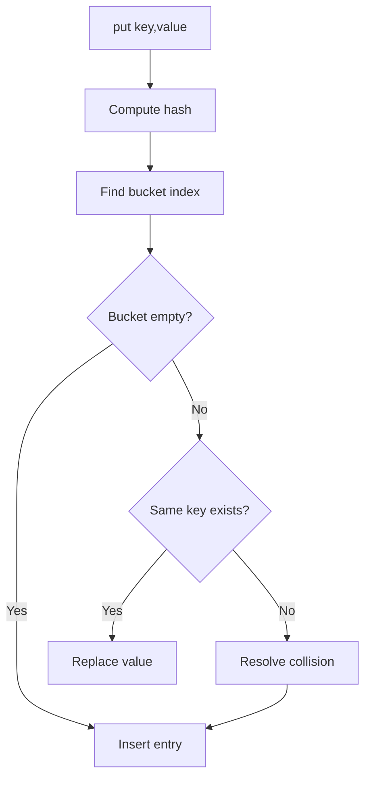
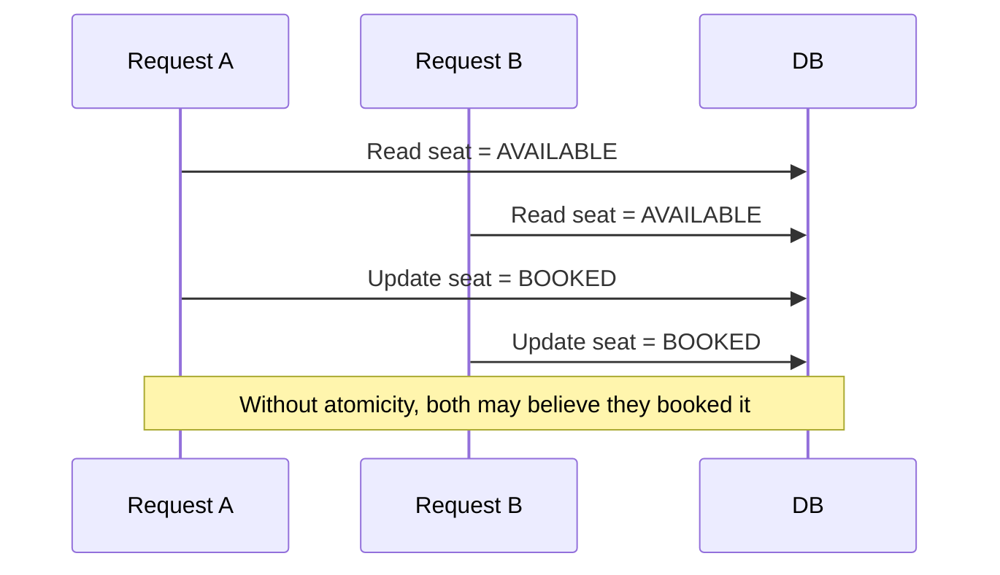
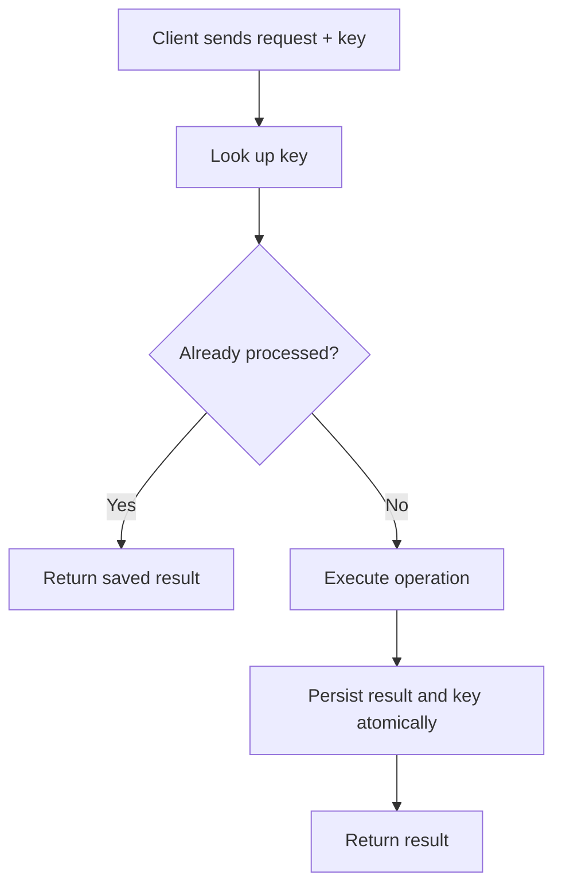

# 03 — Object Modelling and Concurrency

## 1. HashMap: how it works internally

A hash map stores key-value pairs and uses a hash function to find a bucket.

### Basic flow



A common bucket index calculation is `hash(key) % capacity`. Implementations often use bit operations when capacity is a power of two.

### Collision handling
- Separate chaining: a bucket stores multiple entries, often as a linked structure or tree.
- Open addressing: search for another free slot using a probing sequence.

### Complexity
- Average lookup/insert: approximately O(1), assuming a good hash distribution and controlled load factor.
- Worst case: O(n) for a long collision chain (some implementations mitigate this).
- Resize/rehash: O(n) work when capacity grows; amortized insertion remains efficient under normal assumptions.

### Important design details
- Equal keys must produce equal hashes.
- Keys should not mutate in a way that changes their hash while stored.
- Resize threshold is commonly based on load factor = entries / buckets.
- Iteration order may or may not be guaranteed; check the language contract.

## 2. Why concurrency matters in LLD

A design can be logically correct for one request and still fail when two requests execute simultaneously.

Example: two customers try to reserve the last seat. If both read “available” before either writes “booked”, both may succeed. This is a race condition.

## 3. Critical section and race condition

A critical section reads or updates shared state. Protect the entire logical operation, not just one line.



Correctness requires an atomic reservation operation, for example a database transaction with a conditional update:

```sql
UPDATE seats
SET status = 'BOOKED', booking_id = :bookingId
WHERE seat_id = :seatId AND status = 'AVAILABLE';
```

If exactly one row is updated, the reservation succeeded. If zero rows are updated, another request won.

## 4. Mutex / pessimistic locking

Pessimistic locking assumes a conflict may occur and takes a lock before modifying shared state.

- Simple mental model: one thread at a time enters the protected region.
- Good when conflicts are frequent or the operation must serialize.
- Costs: waiting, contention, deadlock risk and reduced throughput.

Use a consistent lock order to reduce deadlocks. Keep critical sections short.

## 5. Optimistic concurrency control

Optimistic locking allows concurrent reads and checks at write time whether the data changed.

Example: a row has version 7. Update succeeds only if the version is still 7; successful update increments it to 8.

```sql
UPDATE seats
SET status = 'BOOKED', version = version + 1
WHERE seat_id = :seatId AND version = :expectedVersion
  AND status = 'AVAILABLE';
```

- Good when conflicts are uncommon.
- Failed updates must be retried or reported as conflicts.
- Retry only when the operation is safe to retry.

### Optimistic vs pessimistic

| Optimistic | Pessimistic |
|---|---|
| Detect conflict during write | Prevent conflict by locking |
| Less waiting when contention is low | Waiting under contention |
| May require retry | May block other requests |
| Version/CAS style | Mutex/row lock style |

## 6. Locking in a multi-instance application

An in-process mutex protects only threads in one process. If the service runs on 5 machines, each process has its own mutex.

For shared data, use a coordination mechanism at the shared resource boundary:
- Database transactions/row locks/unique constraints
- Atomic compare-and-set updates
- A distributed lock only when its failure and lease semantics are understood

Prefer database-enforced invariants for booking and inventory because the database owns the durable shared state.

## 7. Idempotency

An operation is idempotent if repeating it has the same intended effect as performing it once.

For a payment or booking request, accept an idempotency key and store the result associated with that key. A retry returns the original result rather than charging twice.



## 8. Concurrency review checklist

- What state is shared?
- What is the invariant? Example: a seat can have at most one active booking.
- Where is the atomic boundary?
- Can two requests update the same entity?
- What happens after timeout or process crash?
- Can the client safely retry?
- Does a lock work across multiple service instances?
- Are lock ordering and timeout policies defined?
- Are duplicate messages or callbacks possible?
