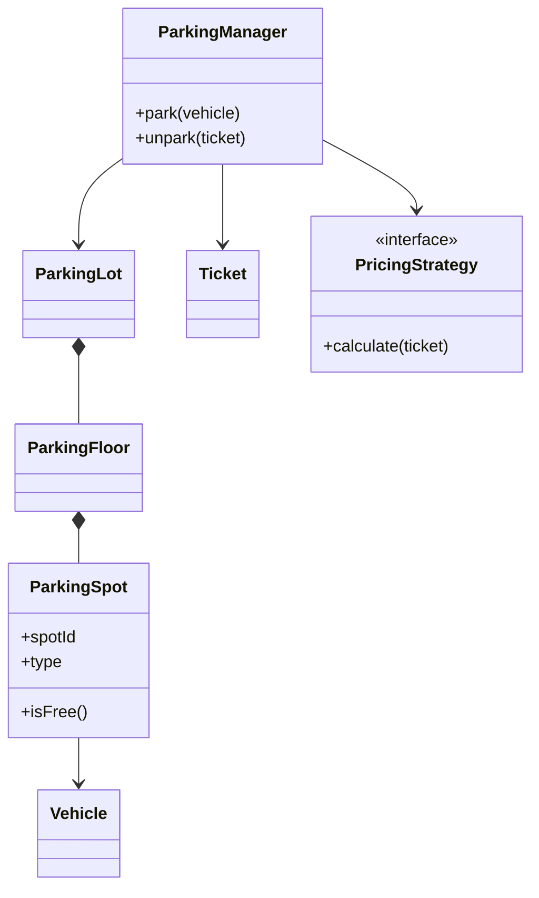
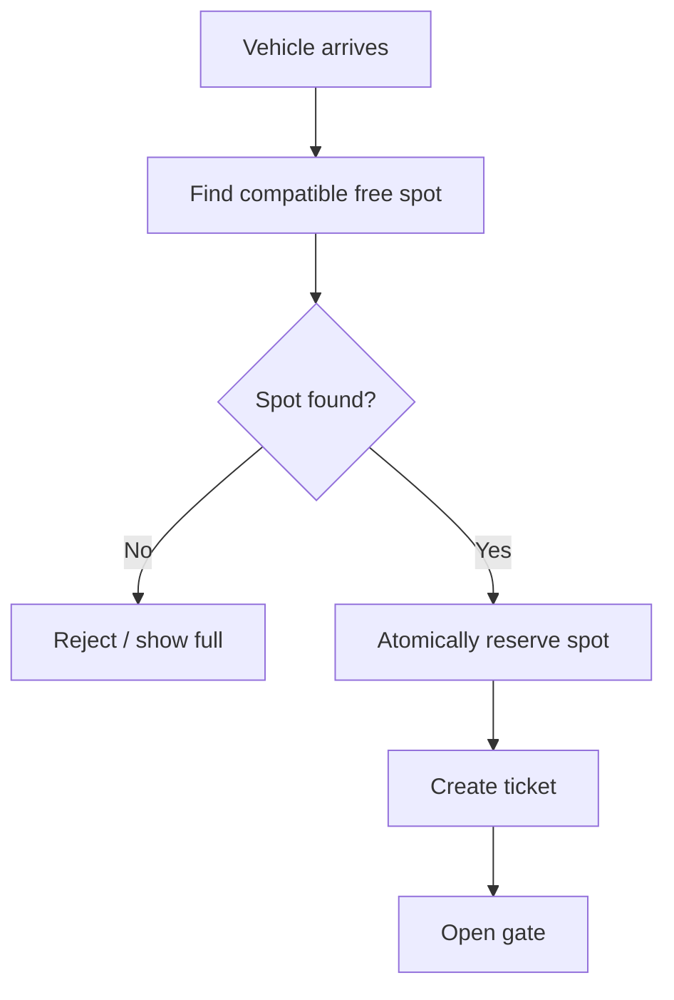
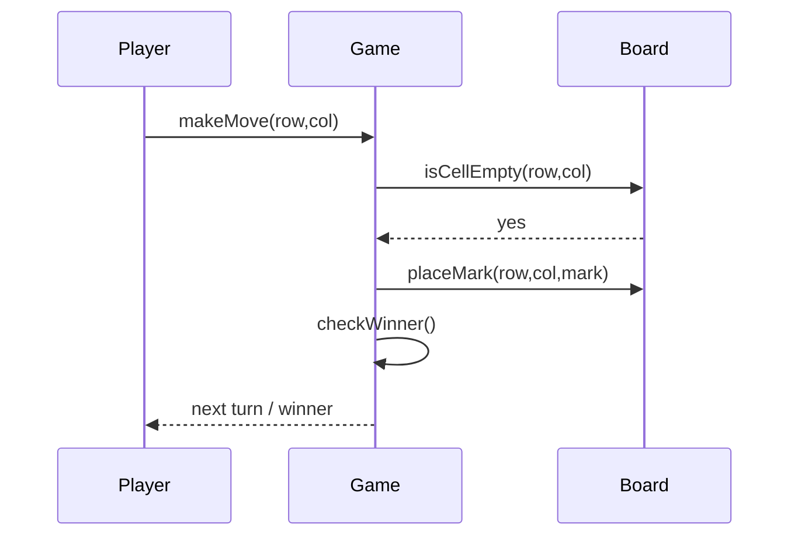
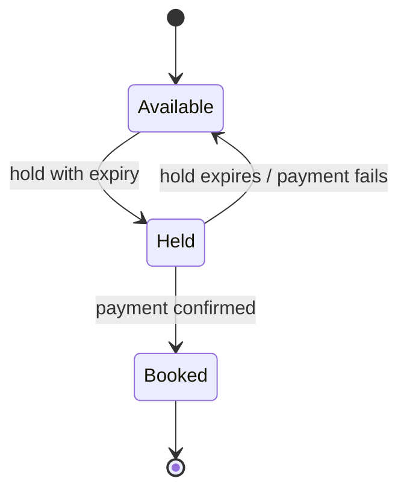

# 04 — LLD Case Studies

For every case study, begin with scope and use cases. The models below are starting points, not the only valid solutions. Add fields and classes only when a requirement justifies them.

## 1. Parking Lot

### Requirements
- Multiple floors and parking spots.
- Different vehicle and spot types.
- Assign a suitable available spot.
- Generate ticket and calculate fee at exit.

### Main objects
`ParkingLot`, `ParkingFloor`, `ParkingSpot`, `Vehicle`, `Ticket`, `ParkingManager`, `PricingStrategy`.

### Park flow

Important: reserve the spot atomically. Two attendants must not allocate the same spot.

## 2. Tic-Tac-Toe

Objects: `Game`, `Board`, `Cell`, `Player`, `Move`, `GameStatus`, `WinningStrategy`.

The board validates a move, updates one cell, checks win/draw and switches the turn. Keep winning detection separate so board sizes or winning rules can change.

## 3. Elevator System

Objects: `ElevatorController`, `ElevatorCar`, `Floor`, `Request`, `Door`, `Scheduler`.

Separate request collection from scheduling. A simple strategy may prioritize direction and nearest requests; a production scheduler also considers fairness, load, maintenance and emergency modes.

States: Idle → MovingUp/MovingDown → DoorOpening → DoorOpen → DoorClosing.

## 4. Car Rental System

Objects: `Customer`, `Vehicle`, `VehicleCategory`, `Branch`, `Reservation`, `RentalAgreement`, `Payment`, `PricingPolicy`.

A reservation should have a time interval, not just a boolean availability flag. Prevent overlapping active reservations for the same vehicle. Distinguish a reservation from the actual rental agreement.

## 5. Logging System — Chain of Responsibility

Objects: `Logger`, `LogLevel`, `LogMessage`, `LogHandler`, `ConsoleHandler`, `FileHandler`, `RemoteHandler`.

A log event passes through configured handlers. Define filtering, formatting, asynchronous buffering, rotation and failure behaviour. A remote sink outage should not necessarily block application threads.

## 6. Snake and Ladder

Objects: `Game`, `Board`, `Player`, `Dice`, `Snake`, `Ladder`, `TurnManager`.

A turn rolls dice, calculates a tentative position, applies snake/ladder mapping and checks the winning condition. Keep board configuration separate from game execution.

## 7. BookMyShow / Movie Ticket Booking

Objects: `Movie`, `Theatre`, `Screen`, `Show`, `Seat`, `SeatHold`, `Booking`, `Payment`.

Key challenge: temporary seat holds and concurrent checkout. A seat hold should expire; final booking must atomically claim the seat. Payment and booking require a clear state machine and compensation strategy.

## 8. Vending Machine

Objects: `VendingMachine`, `ProductSlot`, `Inventory`, `Payment`, `Dispenser`, `MachineState`.

Typical states: Idle, HasMoney, Dispensing, OutOfStock. Reject invalid transitions (for example, dispensing before payment). Return change and handle a dispense failure explicitly.

## 9. ATM

Objects: `ATM`, `CardReader`, `Session`, `Account`, `BankService`, `CashDispenser`, `Transaction`.

Separate ATM hardware from banking domain operations. A withdrawal must check authentication, account balance, daily limits and cash availability. The bank ledger is authoritative; the ATM should reconcile uncertain outcomes.

## 10. Chess

Objects: `Game`, `Board`, `Square`, `Piece`, `Move`, `Player`, `RuleValidator`.

Each piece knows its movement pattern, but the game-level validator must also check whether a move leaves the king in check, handles castling/en passant, and detects checkmate/stalemate. Separate pseudo-legal movement from full legal move validation.

## 11. File System — Composite

Treat both files and directories as `FileSystemEntry`. A directory contains entries; a file is a leaf. Common operations may include name, size and listing. Consider permissions, symbolic links and cycles if the scope requires them.

## 12. Splitwise

Objects: `User`, `Group`, `Expense`, `Split`, `Balance`, `Settlement`, `SplitStrategy`.

Support equal, exact and percentage splits. Store who paid and who owes. Use integer minor currency units (paise/cents) to avoid floating-point rounding errors.

## 13. Cricbuzz / CricInfo

Objects: `Match`, `Team`, `Player`, `Innings`, `Over`, `Ball`, `Scorecard`, `CommentaryEvent`.

Model ball-by-ball events as the source of truth; derive scorecards and summaries. Distinguish legal deliveries from wides/no-balls and model wickets and extras explicitly.

## 14. Online Auction — Mediator

Objects: `Auction`, `Bidder`, `Bid`, `AuctionMediator`, `AuctionStatus`.

Bidders submit bids to the auction coordinator. Validate minimum increment, auction state, bidder eligibility and deadline. Decide how simultaneous bids are ordered (for example, server timestamp plus sequence).

## 15. Payment Gateway

Objects: `PaymentService`, `PaymentRequest`, `PaymentAttempt`, `PaymentGateway`, `PaymentResult`, `RefundService`, `IdempotencyStore`.

Use a gateway abstraction so provider-specific APIs do not leak into business logic. Model Pending, Authorized, Captured, Failed and Refunded separately. Webhooks may be duplicated or delayed; process them idempotently.

## Case-study interview checklist

- State the assumptions and out-of-scope items.
- Identify core entities and value objects.
- Explain one primary flow with a sequence diagram.
- Explain one failure flow.
- Identify invariants and concurrency boundaries.
- Explain where patterns help and where they would be unnecessary.
- Describe how you would test the design.
