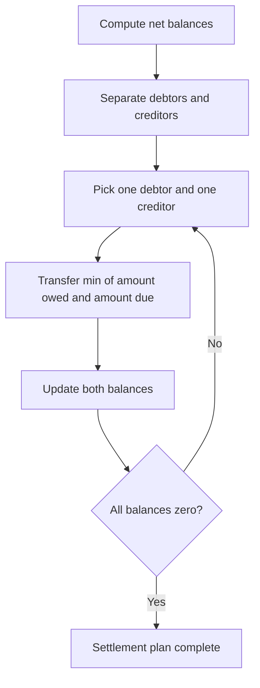
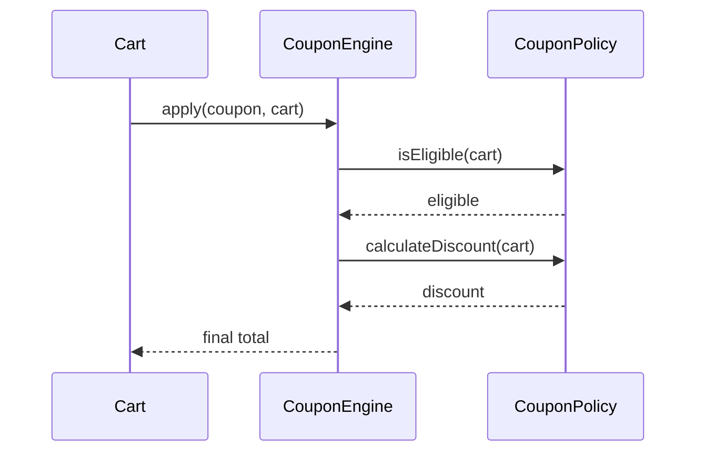
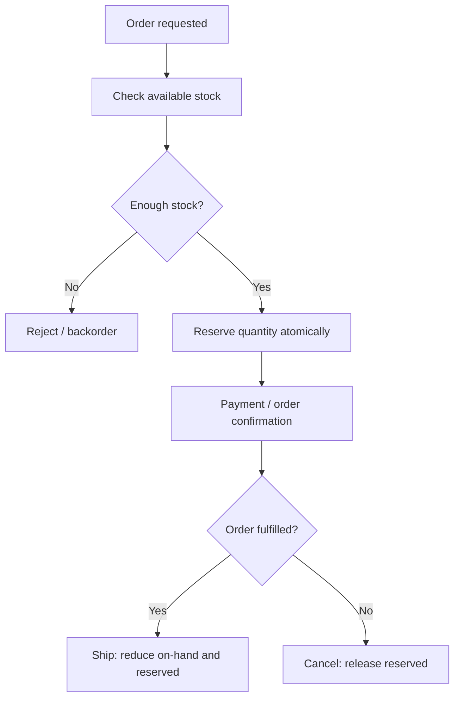
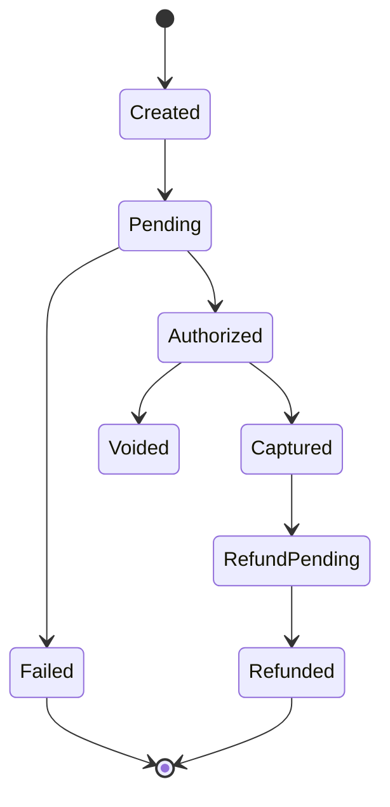

# 05 — Algorithms and Design Exercises

## 1. Splitwise: simplify debts

Represent each person's net balance:
- Positive: the person should receive money.
- Negative: the person owes money.

For each expense, update payer and participants according to the split. To settle, repeatedly match one debtor with one creditor.

### Greedy settlement flow


This simple greedy approach produces a valid settlement plan and is easy to explain. It does not always prove the globally minimum number of transactions for every variant. If minimum transaction count is required, discuss search/backtracking and its exponential worst-case complexity.

Use integer minor units (for example, paise) and define rounding rules for percentage splits.

## 2. Shopping cart coupons

Model a coupon as a policy with eligibility and discount calculation:
- Fixed amount off
- Percentage off
- Category-specific
- Minimum cart value
- Maximum discount
- First-order/customer-specific

Avoid hard-coding every coupon in a large conditional block.



Important decisions: Can coupons stack? Which order is applied? Is discount applied before tax or after tax? Can discount exceed item total? Define these rules explicitly.

## 3. Inventory Management System

Core objects: `Product`, `SKU`, `Warehouse`, `StockLevel`, `Reservation`, `PurchaseOrder`, `StockMovement`.

Keep on-hand, reserved and available quantities distinct:

`available = onHand - reserved`

When an order is placed, reserve stock atomically. On shipment, reduce on-hand and release reservation. On cancellation, release reservation without shipping.



For concurrent orders, use a database conditional update or transaction. A read-then-write in application memory is not enough.

## 4. Cache design

A cache stores frequently used data closer to the caller to reduce latency and load on the source.

### Common operations
`get(key)`, `put(key,value)`, `remove(key)`.

### Eviction policies
- LRU: evict least recently used.
- LFU: evict least frequently used.
- FIFO: evict oldest inserted item.
- TTL: expire entries after a configured time.

A common LRU implementation combines a hash map and doubly linked list:
- Hash map gives O(1) lookup of a node.
- List gives O(1) move-to-front and remove-tail.
- Overall get/put are O(1) average.

### LRU flow
```mermaid
flowchart TD
 A[get(key)] --> B{Key in map?}
 B -->|No| C[Return cache miss]
 B -->|Yes| D[Move node to list head]
 D --> E[Return value]
 F[put(key,value)] --> G{Key exists?}
 G -->|Yes| H[Update and move to head]
 G -->|No| I[Insert at head and map]
 I --> J{Capacity exceeded?}
 J -->|Yes| K[Remove tail and map entry]
 J -->|No| L[Done]
 K --> L
```

Decide whether cache operations must be thread-safe. Also discuss stale data, invalidation, cache stampede and what happens on cache failure.

## 5. Payment processing exercise

A robust payment flow should distinguish request acceptance from final settlement.



Use idempotency keys for client retries. Store provider transaction IDs. Verify webhook signatures. Treat provider callbacks as at-least-once delivery and make handlers idempotent. Do not assume a timeout means the provider did not process the payment.

## 6. Exercise prompts

1. Add multi-currency support to Splitwise. Where should conversion rates be captured?
2. Add coupon stacking. How do you make order deterministic?
3. Add multiple warehouses. How do you select a fulfilment location?
4. Add TTL to an LRU cache. When is an entry considered expired?
5. Two customers order the last item. Which layer enforces correctness?
