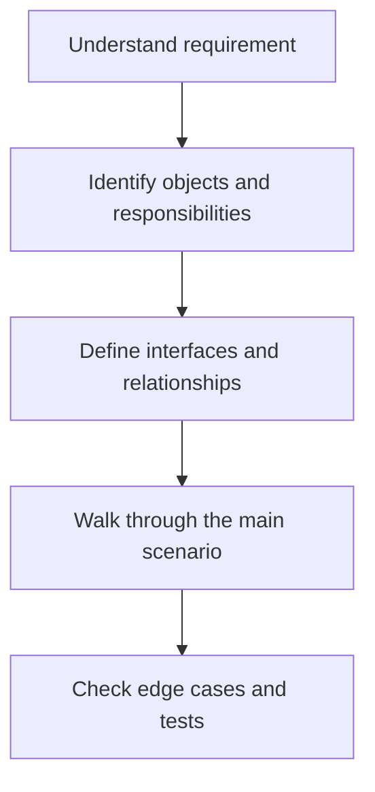

# 07 — Decorator Pattern

**Playlist lesson:** 7 of 43  
**Author:** Jayesh Sharma  
**Focus:** Simple explanation, practical example and interview preparation.

## 1. Core idea

Decorator wraps an object implementing the same interface and adds behaviour before or after delegating. Decorators can be composed at runtime.

## 2. Design workflow



## 3. Example and design decisions

Wrap a file writer with compression and encryption. Order matters: compress before encrypting.

## 4. What to remember

- Start from requirements and use cases, not from a pattern name.
- Give each class a clear responsibility and protect its invariants.
- Prefer composition and focused interfaces when they reduce coupling.
- Identify error paths, object lifecycle and concurrent access where relevant.
- Add abstractions only when they isolate a real point of change.

## 5. Interview practice

Explain the design in two minutes. Draw the key classes and one sequence. Then answer: what can change, what can fail, and what must remain true when two requests arrive together?

## 6. Java implementation example

Java is used for the implementation examples in this study library. Prefer interfaces for variable behaviour, constructor injection for dependencies, enums for finite states, and immutable value objects where practical.

```java
// Define a small contract for the behaviour that may vary.
interface Operation {
    void execute();
}

class ApplicationService {
    private final Operation operation;

    ApplicationService(Operation operation) {
        this.operation = operation;
    }

    void run() {
        operation.execute();
    }
}
```

The application service depends on an abstraction, not a concrete implementation. In a real solution, replace `Operation` with the topic-specific interface and provide the appropriate implementation. Use Java collections, exceptions and concurrency utilities where they make the design clearer; avoid introducing patterns without a requirement.
---
*LLD Study Library · Author: Jayesh Sharma*
