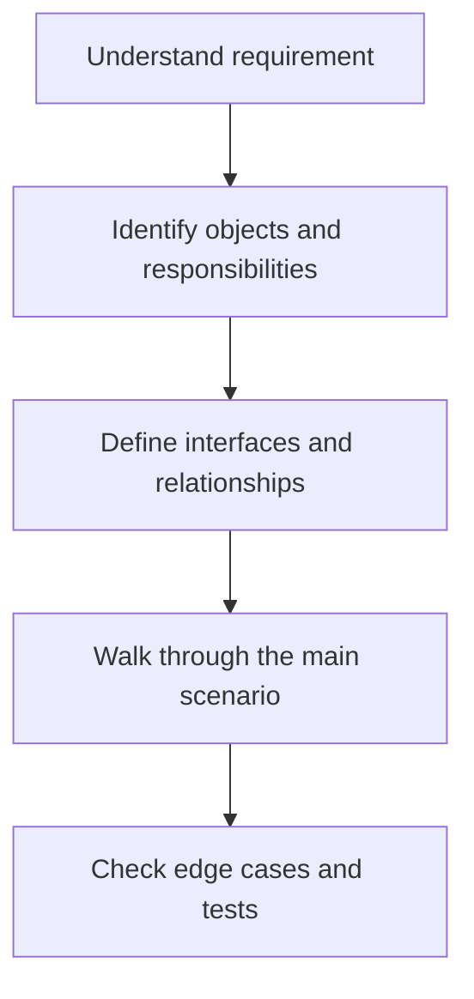

# 18 — Optimistic and Pessimistic Concurrency

**Playlist lesson:** 18 of 43  
**Author:** Jayesh Sharma  
**Focus:** Simple explanation, practical example and interview preparation.

## 1. Core idea

Pessimistic locking acquires a lock before modifying shared data. Optimistic control allows work to proceed and checks a version at update time.

## 2. Design workflow

## 3. Example and design decisions

Use optimistic versioning when conflicts are rare; use row locking when contention is frequent or the critical operation requires serialization.

## 4. What to remember

- Start from requirements and use cases, not from a pattern name.
- Give each class a clear responsibility and protect its invariants.
- Prefer composition and focused interfaces when they reduce coupling.
- Identify error paths, object lifecycle and concurrent access where relevant.
- Add abstractions only when they isolate a real point of change.

## 5. Interview practice

Explain the design in two minutes. Draw the key classes and one sequence. Then answer: what can change, what can fail, and what must remain true when two requests arrive together?

## 6. C++ implementation hints

- Use enum class for finite states and clear domain types for identifiers and money.
- Use RAII and smart pointers according to ownership; do not use shared_ptr by default.
- Inject dependencies through constructors instead of relying on global state.
- Protect the complete logical operation when shared mutable state is involved.
- Test normal flow, invalid input, boundaries and failure handling.

---
*LLD Study Library · Author: Jayesh Sharma*
