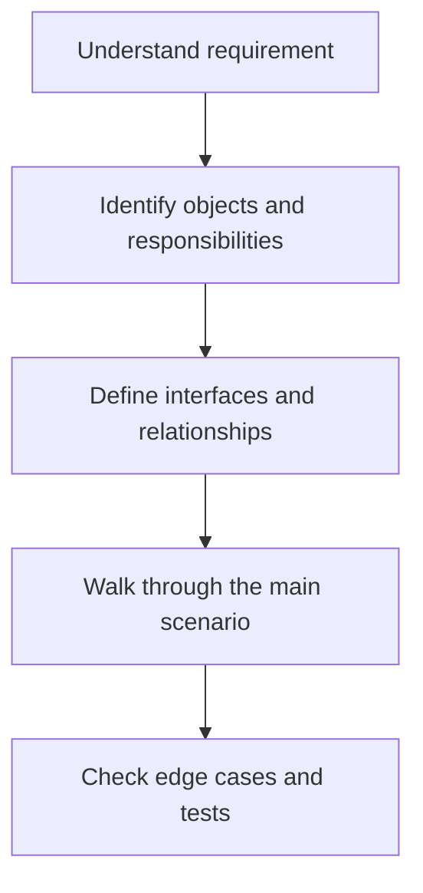

# 29 — Facade Pattern

**Playlist lesson:** 29 of 43  
**Author:** Jayesh Sharma  

## 1. Core idea

Facade offers a small entry point to a complex subsystem. It coordinates lower-level components but should not become a giant business-logic class.

## 2. Design workflow



## 3. Example and design decisions

CheckoutFacade may coordinate inventory, payment and order services while each service retains its own responsibility.

## 4. What to remember

- Start from requirements and use cases, not from a pattern name.
- Give each class a clear responsibility and protect its invariants.
- Prefer composition and focused interfaces when they reduce coupling.
- Identify error paths, object lifecycle and concurrent access where relevant.
- Add abstractions only when they isolate a real point of change.

## 5. Interview practice

Explain the design in two minutes. Draw the key classes and one sequence. Then answer: what can change, what can fail, and what must remain true when two requests arrive together?

## 6. Java implementation example

Use Java interfaces for variable behaviour, constructor injection for dependencies, enums for finite states, and immutable value objects where practical.

```java
interface Operation {
    void execute();
}

class ApplicationService {
    private final Operation operation;
    ApplicationService(Operation operation) { this.operation = operation; }
    void run() { operation.execute(); }
}
```

The service depends on an abstraction rather than a concrete implementation. In a real solution, replace `Operation` with the topic-specific interface and supply the required implementation. Use Java collections, exceptions and concurrency utilities where they improve clarity; do not introduce patterns without a requirement.
---
*LLD Study Library · Author: Jayesh Sharma*
