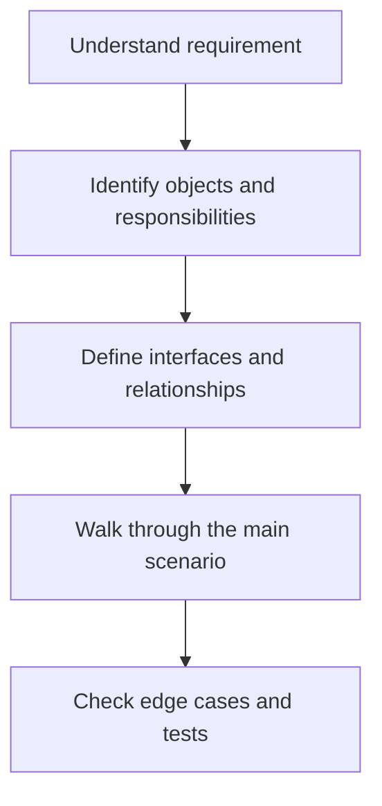

# 41 — MVC Pattern

**Playlist lesson:** 41 of 43  
**Author:** Jayesh Sharma

## 1. Core idea

MVC separates Model (domain data and rules), View (presentation) and Controller (input coordination). The controller invokes application behaviour and returns a response or view.

## 2. Design workflow

## 3. Example and design decisions

Do not put all business rules in controllers. Keep domain rules independent of UI technology where possible.

## 4. What to remember

- Start from requirements and use cases, not from a pattern name.
- Give each class a clear responsibility and protect its invariants.
- Prefer composition and focused interfaces when they reduce coupling.
- Identify error paths, object lifecycle and concurrent access where relevant.

## 5. Interview practice

Explain the design in two minutes. Draw the key classes and one sequence. State one trade-off and one test for an edge case.

## 6. C++ implementation hints

- Use RAII and smart pointers according to ownership.
- Inject dependencies through constructors instead of relying on global state.
- Use const-correct interfaces and explicit state types.
- Test normal flow, invalid input, boundaries and failure handling.

---
*LLD Study Library · Author: Jayesh Sharma*
